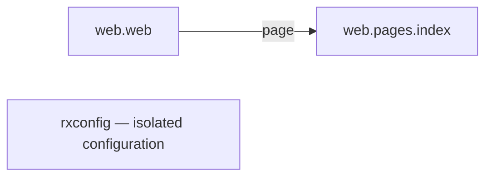

# CMU Database Group: search over lecture transcripts

[](https://molab.marimo.io/github/elviskahoro/cmu-database-group-lectures/blob/main/notebooks/search.py)

Hybrid (vector + full-text) search over 595 CMU Database Group lectures
(33,412 chunks). Results deep-link to the YouTube timestamp.

## How it fits together

1. **Transcribe**: Whisper large-v3 on Modal reads audio from R2 and writes
   `*·transcription.json` to the `cmu-transcripts` Modal volume (the script
   lives in the `epic-sermons` repo, `src/youtube/transcribe_r2.py`).
2. **Chunk and embed**: `lecture_search/chunking.py` makes ~75 s windows with
   ~15 s overlap; `lecture_search/quality.py` drops degenerate Whisper chunks;
   Nomic v1.5 embeddings come from Fireworks (`search_document:` prefix, with trailing space).
3. **Load**: `scripts/load_corpus.py` writes to the LanceDB Cloud table `lectures`.
4. **Serve**: the Modal app `cmu-lecture-search` (`lecture_search/search_api.py`)
   holds the LanceDB key and runs hybrid search.
5. **Use**: `notebooks/search.py` (marimo, deployed on molab) embeds the query
   itself (`search_query:` prefix) and sends the vector to the Modal app.

## Runbook

```bash
uv sync
set -a && . ./.env.local && set +a  # needs LANCEDB_API_KEY, FIREWORKS_API_KEY

# Pull transcripts (Modal profile marcella)
MODAL_PROFILE=marcella modal volume get --force cmu-transcripts /transcription data/corpus

# Dry-run the chunking and quality filter, then load (idempotent; embeddings are cached)
uv run python scripts/load_corpus.py --transcripts-dir data/corpus/transcription --dry-run
uv run python scripts/load_corpus.py --transcripts-dir data/corpus/transcription --table lectures

# Redeploy the search API
MODAL_PROFILE=marcella modal deploy lecture_search/search_api.py

# Check retrieval quality, then run the notebook locally
uv run python -m scripts.retrieval_check
uv run marimo run notebooks/search.py
```

- LanceDB Cloud has no read-only keys, so the key only ever lives in the Modal secret.
- A fresh table is bulk-loaded with `add()`. `merge_insert` on Cloud fails once
  more than 10k rows are un-indexed, so it is only used for re-runs.
- Known gaps: `tEa5sAh-kVk` is not searchable (Whisper loop); `6H0yuYPHw0Q`,
  `YeNF3pJwLKw` and `OIT9Y1IBZUU` only have their good parts indexed.
- More detail: `docs/search-api.md`, `docs/molab-deployment.md`,
  `docs/retrieval-check.md`, `docs/corpus-quality.md`, `docs/lancedb-findings.md`.

---

## Reflex starter template (inherited, unrelated to search)

Production-ready [Reflex](https://reflex.dev) starter that deploys to [Railway](https://railway.app) via Docker. The frontend is pre-built into static assets at image build time and served by Caddy; the Reflex backend runs on a separate port and is reverse-proxied for `_event` and `_upload` routes.

This document is written for an autonomous agent. Follow the sections in order. Each command is the literal command to run; do not paraphrase. When a step says "verify", do not skip — stop and report if the check fails.

---

## 1. What gets deployed

- **Frontend**: Next.js static export, built at Docker image build time, served by Caddy on `$PORT` (Railway sets this; defaults to `8080` per `railway.toml`).
- **Backend**: Reflex Python backend on `localhost:8000`, started by `entrypoint.sh`.
- **Reverse proxy**: Caddy proxies `/_event/*`, `/_upload`, and `/_upload/*` to the backend; everything else is served as a static file with SPA fallback to `/404.html`.
- **Health check**: `GET /ping` returns `pong` (used by Railway and the Docker `HEALTHCHECK`).

The split-process model (Caddy + backend, supervised by `entrypoint.sh`) is what lets a single Railway service serve both the static frontend and the WebSocket backend on one port.

---

## 2. Repository layout

```text
.
├── Caddyfile              # Caddy config: static + reverse proxy to backend
├── Dockerfile             # Alpine + Python 3.11 + Node + Caddy; pre-builds frontend
├── DEPLOYMENT.md          # Railway-specific notes (kept for reference)
├── README.md              # This file
├── assets/                # Static assets (favicon, etc.)
├── entrypoint.sh          # Starts backend + Caddy, supervises both
├── pyproject.toml         # Python project; pinned reflex version
├── railway.toml           # Railway build/deploy config
├── rxconfig.py            # Reflex config: app_name="web", sitemap plugin, no watermark
├── symlink/               # Git submodule (https://github.com/elviskahoro/skills-reflex)
├── uv.lock                # uv lockfile (frozen install)
└── web/                   # Reflex app package (matches app_name in rxconfig.py)
    ├── __init__.py
    ├── web.py             # rx.App() + page registration
    ├── components/
    │   └── status_card/   # Example reusable component (state passed in as arguments)
    └── pages/
        └── index/
            ├── __init__.py
            └── page.py    # IndexState + page() component
```

The Reflex package name is `web` (see `rxconfig.py`'s `app_name`). If you rename the package, update both `rxconfig.py` and the `from web.pages...` imports.

---

## 3. Prerequisites

Required on the deploy host (Railway provides all of these in the Docker build; only needed locally for dev):

- Python `>=3.11` (the Dockerfile uses `python:3.11-alpine`)
- [`uv`](https://github.com/astral-sh/uv) for dependency management
- Node.js + npm (Reflex compiles a Next.js frontend)
- Docker (to test the production image locally)
- A Railway account + the [Railway CLI](https://docs.railway.app/develop/cli) (`npm i -g @railway/cli`) for CLI-based deploys

---

## 4. First-time setup (local clone)

```bash
git clone --recurse-submodules <repo-url> reflex-starter-template
cd reflex-starter-template
uv sync --frozen
```

The `--recurse-submodules` flag is required because `.gitmodules` references `symlink` → `https://github.com/elviskahoro/skills-reflex`. If you already cloned without it:

```bash
git submodule update --init --recursive
```

Verify the env:

```bash
uv run reflex --version    # should print a 0.8.x version
```

---

## 5. Run locally (development)

```bash
uv run reflex init     # one-time; populates .web/
uv run reflex run      # starts dev server on http://localhost:3000
```

Visit `http://localhost:3000`. The default page (`web/pages/index/page.py`) renders a counter that calls the backend on click — use this as the smoke test that the backend wiring works.

### Check architecture

Tach is pinned in the development dependencies. After `uv sync --frozen`, run:

```bash
uv run --frozen tach check
uv run --frozen tach check-external
```

Trunk runs both checks when Python files, `tach.toml`, `pyproject.toml`, or
`uv.lock` change. Any nonzero exit status fails the check, including graph-wide
errors without a file or line number.

`tach.toml` requires explicit, used dependencies and rejects circular dependencies.
Imports under `TYPE_CHECKING` and inside functions follow the same boundaries.
String import detection is enabled for module paths containing at least two dots
(Tach's supported scope). Every configurable rule is an error, including unused
suppression comments and suppressions without a reason. Checks include ignored
source files; only the tooling, generated, and vendored directories listed in
`tach.toml` are excluded. Unconfigured root modules cannot participate in local
dependencies.

The graph is adapted to the modules that exist in this Reflex app:



The `web` and `web.pages` namespaces also have no dependencies. New modules under
`web.*` and new pages under `web.pages.*` receive separate boundaries with no
allowed dependencies, external packages, or consumers. Each page remains one
module, including its `__init__.py`, view, and state implementation. Modules have
no public members by default; the index page exposes only `page` to `web.web`.
That interface is exclusive, so adding another interface cannot silently widen
the app's access to the page internals.

The page layer is closed: if a shared layer is added beneath it, the app must
access it through pages. Page implementations cannot import application or
configuration entrypoints or other pages. When adding a page or dependency,
declare its module, layer, visibility, external dependencies, and public interface
in `tach.toml`, then rerun both checks. Avoid `tach sync` as a routine fix: it can
authorize an unintended dependency.

These rules follow Tach's documentation for
[module defaults](https://github.com/gauge-sh/tach/blob/v0.35.3/docs/usage/configuration.md#modules),
[exclusive interfaces](https://github.com/gauge-sh/tach/blob/v0.35.3/docs/usage/interfaces.md#example-exclusive-interface),
and [closed layers](https://github.com/gauge-sh/tach/blob/v0.35.3/docs/usage/layers.md#closed-layers).

---

## 6. Build and run the production image locally

This is the deployable artifact. Test it before pushing.

```bash
docker build -t reflex-app .
docker run --rm -p 8080:8080 -e PORT=8080 reflex-app
```

Verify:

```bash
curl -f http://localhost:8080/ping        # expect: pong
curl -fI http://localhost:8080/           # expect: 200, served by Caddy
```

Open `http://localhost:8080/` in a browser and click the "Test Backend" button — the counter must increment, which proves Caddy is correctly proxying `/_event/*` to the backend on `:8000`.

If `/ping` returns `pong` but the button does nothing, the backend or the reverse-proxy block in `Caddyfile` is broken. Check container logs.

---

## 7. Deploy to Railway

Two options. Use **CLI** for repeatable, scripted deploys. Use **GitHub** for continuous deploys on push.

### Option A — CLI deploy (recommended for agents)

```bash
railway login                 # opens a browser; the user must complete this once
railway link                  # select existing project, or:
railway init                  # create a new project
railway up                    # builds the Dockerfile and deploys
```

After `railway up` completes:

```bash
railway domain                # generate a public *.up.railway.app domain
railway logs                  # tail deployment logs
railway status                # confirm service is RUNNING
```

Verify the public URL:

```bash
curl -f https://<your-domain>.up.railway.app/ping     # expect: pong
```

### Option B — GitHub-connected deploy

1. Push the repo to GitHub.
2. In Railway dashboard: **New Project → Deploy from GitHub repo** → select repo.
3. Railway auto-detects the `Dockerfile` and builds.
4. In the service: **Settings → Networking → Generate Domain**.

`railway.toml` already configures: Dockerfile builder, `/ping` healthcheck, 30s draining, restart-on-failure (max 5), and `PORT=8080`.

### Environment variables

Already set in `railway.toml` (`[env]` block):

- `REFLEX_ENV=prod`
- `PYTHONUNBUFFERED=1`
- `PORT=8080`

Add any app secrets via the Railway dashboard (**Variables** tab) or:

```bash
railway variables --set KEY=VALUE
```

Do **not** put secrets in `railway.toml` — it is committed to git.

---

## 8. Customization

### Rename the app package

The Reflex package is `web/`. If renaming to e.g. `myapp`:

1. `mv web myapp`
2. Update `rxconfig.py`: `app_name="myapp"`
3. Update imports in `myapp/web.py`: `from myapp.pages.index import page`
4. Rebuild the image (`docker build ...`) — the `reflex export --frontend-only` step in the Dockerfile re-reads `rxconfig.py`.

### Add a page

1. Create `web/pages/<name>/page.py` exporting a `page()` function returning `rx.Component`.
2. Create `web/pages/<name>/__init__.py` re-exporting `page`.
3. Register in `web/web.py`:

   ```python
   from web.pages.<name> import page as <name>_page
   app.add_page(component=<name>_page, route="/<name>", title="...")
   ```

### Watermark

`show_built_with_reflex=False` is set in `rxconfig.py`. Do not re-add it.

---

## 9. Troubleshooting

| Symptom | Likely cause | Fix |
| --- | --- | --- |
| Build OOM on Railway | Free tier has ~512MB; Next.js build can exceed it | Upgrade plan; the Dockerfile already pre-builds + discards `.web` to minimize runtime memory |
| `/ping` works, page loads, but button does nothing | Caddy not proxying `/_event/*`, or backend not running | `railway logs`; verify `entrypoint.sh` started both processes; check `Caddyfile` `@backend_routes` block |
| `502 Bad Gateway` on first request after deploy | Backend still warming up (first request triggers state init) | Wait 30–60s; healthcheck has `start-period=10s` but cold start can be longer |
| `reflex: command not found` in container | uv sync failed or `.venv/bin` not used | Confirm `uv sync --frozen --no-dev` succeeded in the build logs; entrypoint uses `.venv/bin/reflex` explicitly |
| Submodule `symlink/` empty | Cloned without `--recurse-submodules` | `git submodule update --init --recursive` |
| Watermark reappears | `rxconfig.py` was edited or overridden | Restore `show_built_with_reflex=False` |
| `npm error code EOVERRIDE` when rebuilding `reflex.lock/` with npm | The `"vite": "8.3.5"` security override in `reflex.lock/package.json` conflicts with Reflex 0.10.0's re-pinned `devDependencies.vite` (`8.3.2`); npm, unlike bun, rejects an override that conflicts with a direct dependency | Stay on bun for frontend rebuilds (`bun install --frozen-lockfile` in `reflex.lock/`) until Reflex ships a vite pin of 8.3.5 or later; then drop the override |

For a deeper dive into Railway-specific failure modes, see [`DEPLOYMENT.md`](./DEPLOYMENT.md).

---

## 10. End-to-end agent checklist

Run these in order from a fresh clone. Each must succeed before the next.

1. `git clone --recurse-submodules <url> && cd reflex-starter-template`
2. `uv sync --frozen` → exit 0
3. `docker build -t reflex-app .` → exit 0
4. `docker run --rm -d -p 8080:8080 -e PORT=8080 --name rx-test reflex-app`
5. `sleep 15 && curl -f http://localhost:8080/ping` → prints `pong`
6. `curl -fI http://localhost:8080/` → `200 OK`
7. `docker rm -f rx-test`
8. `railway login` (interactive — surface to user if non-interactive)
9. `railway link` or `railway init`
10. `railway up` → build succeeds, deploy reaches `SUCCESS`
11. `railway domain` → capture public URL
12. `curl -f https://<domain>/ping` → prints `pong`

If any step fails, stop and report the failing step number, the command, and the full error output. Do not attempt destructive recovery (do not run `railway down`, `git reset --hard`, or delete the Railway project) without explicit user confirmation.

---

## Lecture search notebook (marimo)

[](https://molab.marimo.io/github/elviskahoro/cmu-database-group-lectures/blob/main/notebooks/search.py)

`notebooks/search.py` is a self-contained (PEP 723) marimo notebook for hybrid
search over the full `lectures` corpus (594 CMU Database Group lectures,
33k chunks, Nomic v1.5 embeddings). The notebook never touches LanceDB: it
embeds the query locally (GPU if available, else CPU) and calls the public
Modal search API (`docs/search-api.md`). It provides a query form with a
top-k slider, a hybrid vector↔full-text weight slider, optional date-range
and lecture filters, and renders results with title/date, a
timestamped YouTube deep link, a text snippet, and the relevance score.

No secrets required — the search API is public and read-only. The API base
URL is a constant at the top of the notebook.

```bash
uv run marimo run notebooks/search.py   # interactive
uv run notebooks/search.py              # headless: runs sample queries
uvx marimo check notebooks/search.py    # lint
```

---

## Lecture search pipeline runbook

End-to-end pipeline for searching CMU Database Group lecture transcripts.
The **sample run** (6 videos, 275 chunks, table `lectures_sample`) is
complete and verified; see below for what changes to scale to all **595
lectures**.

### Pipeline (sample, as built)

1. **Transcribe** lecture audio with Whisper `large-v3` on Modal (in the
   `epic-sermons` repo). Output per video: a Whisper JSON transcript
   (`dict` with `segments[{start, end, text}]`), named
   `YYYY-MM-DD·video_id·transcription.json`; titles come from the matching
   `.kson` assets when present (`data/sample/titles.json` for the sample).
2. **Chunk** transcripts with `lecture_search.chunking`
   (`process_sample_transcripts`) into timestamped `ChunkRecord`s with
   YouTube deep links.
3. **Embed** locally on CPU with Nomic `nomic-ai/nomic-embed-text-v1.5`
   (768d). Prefixes are prepended client-side, exactly once:
   `search_document:` for chunks, `search_query:` for queries (both with a
   trailing space)
   (`lecture_search/embed.py`; guarded by `tests/test_embed_prefix.py`).
4. **Load** into LanceDB Cloud (`db://cmu-database-group-eqdwgi`,
   `us-east-1`) with an idempotent `merge_insert` upsert, plus an FTS index
   on `text`: `uv run python -m scripts.load_sample`
   (see `docs/lectures-sample.md`).
5. **Search** with `notebooks/search.py` (hybrid vector + FTS,
   `MRRReranker`, adjustable weight).
6. **Verify retrieval** with `uv run python -m scripts.retrieval_check` —
   runs 15 queries against the full `lectures` table, vector-only vs hybrid
   (fts_weight 0.2/0.5/0.8), asserts the expected lecture lands in the top
   10, and writes `data/retrieval_check.json` (results:
   `docs/retrieval-check.md`; currently PASS, 15/15 in every mode).

Secrets: `LANCEDB_API_KEY` (and `FIREWORKS_API_KEY` for the parity gate)
live in `.env.local`; load via the environment, never echo or commit them.

### Scaling to all 595 lectures

- **Transcribe all 595 on Modal — requires explicit user cost approval
  first (estimated $37–149).** Use `MODAL_PROFILE=marcella` (authenticated
  2026-11-02). Known-good config: **A10G GPU** with `WHISPER_BATCH_SIZE=16`
  (4 full lectures transcribed in 71–83 min each, ~180 wpm). **Avoid L4 —
  it hung.** Two caveats: the `whisper-model-cache` volume only exists in
  the `elviskahoro` workspace, so marcella's first run re-downloads
  `large-v3`; and billing on marcella is unconfirmed — confirm before
  spend. The GPU/batch env vars currently live **uncommitted** on the
  `epic-sermons` branch `perf/whisper-batching`; commit or port them before
  the full run.
- **Re-run the Fireworks parity gate before the full load**
  (`uv run python -m scripts.parity_gate`, see `docs/parity-gate.md`) if
  switching to hosted embeddings; it needs `FIREWORKS_API_KEY` in
  `.env.local`. The sample passed (mean cosine ~0.99998); Fireworks embeds
  input verbatim, so keep the client-side prefixes. No Fireworks/Modal
  spend without user approval.
- **Loader is already idempotent** (`merge_insert` on chunk id), so the
  full load is the same `scripts/load_sample.py` pointed at the full
  transcript directory, into a full-corpus table.
- **Add an IVF_PQ vector index** at full-corpus scale — the sample's
  exact sequential scan stops being acceptable well before 595 lectures'
  worth of chunks (`docs/lectures-sample.md`).
- **Re-run the retrieval check on the full corpus**, including the three
  deferred queries (B+ tree vs skip list, Raft leader election, columnar
  storage/vectorized execution) — `docs/retrieval-check.md`.
- **New-video ingest**: when a new lecture is published, transcribe it on
  Modal, drop the JSON next to the others, and re-run the loader — the
  upsert makes re-runs safe and only new chunks are embedded.
